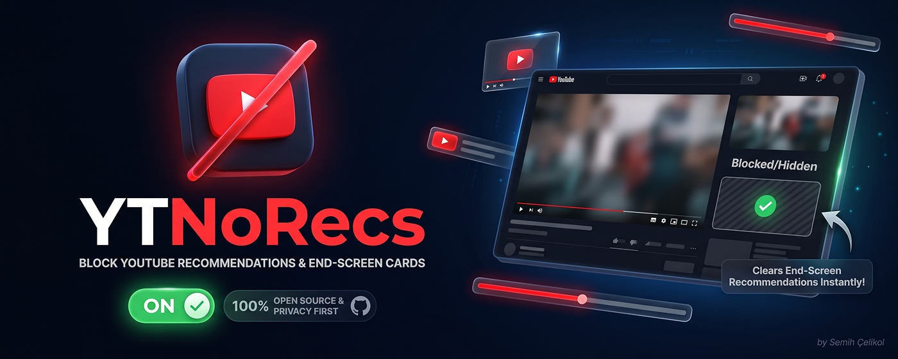

<div align="center">

<!-- Buraya oluşturduğumuz 1400x560 banner görselini ekleyebilirsin -->


# YTNoRecs - Block YouTube Recommendations

**Instantly hide distracting end-screen cards and channel buttons on YouTube videos.**

[](https://addons.mozilla.org/tr/firefox/addon/block-youtube-recommendations/)
[](#) <!-- Chrome linkini yayınlayınca buraya ekle -->
[](#)
[](https://www.buymeacoffee.com/semihc)

</div>

## 🚀 About The Project

Tired of massive end-screen recommendation cards covering the video just as it's about to finish? 

**YTNoRecs** is a lightweight, open-source browser extension that allows you to hide these distracting elements instantly and permanently with a single click. Enjoy a clean, uninterrupted viewing experience until the very last second of every video.

### ✨ Key Features

* **Instant Blocking:** Clears all end-screen video suggestions, channel links, and subscribe cards.
* **Set It & Forget It (Global State):** Once activated, it remembers your preference across all open YouTube tabs and future browser sessions.
* **Highly Optimized:** Only runs on `youtube.com`. It remains completely inactive on other websites to save system resources.
* **Privacy First:** YTNoRecs does not track, collect, or store any personal data. 

---

## 📸 Screenshots

| 🔴 Without YTNoRecs (Non-Blocked) | 🟢 With YTNoRecs (Blocked) |
|:---:|:---:|
|  |  |

---

## 📦 Installation

### Officially Supported Stores
* **Firefox:** Download from the [Mozilla Add-ons Store](https://addons.mozilla.org/tr/firefox/addon/block-youtube-recommendations/).
* **Chrome:** Download from the Chrome Web Store *(Link coming soon)*.

### Manual Installation (For Developers)
If you want to install the extension manually or contribute to the source code:

1. Clone the repository:
   ```bash
   git clone [https://github.com/semihcelikol/blockYoutubeRecommendations.git](https://github.com/semihcelikol/blockYoutubeRecommendations.git)
